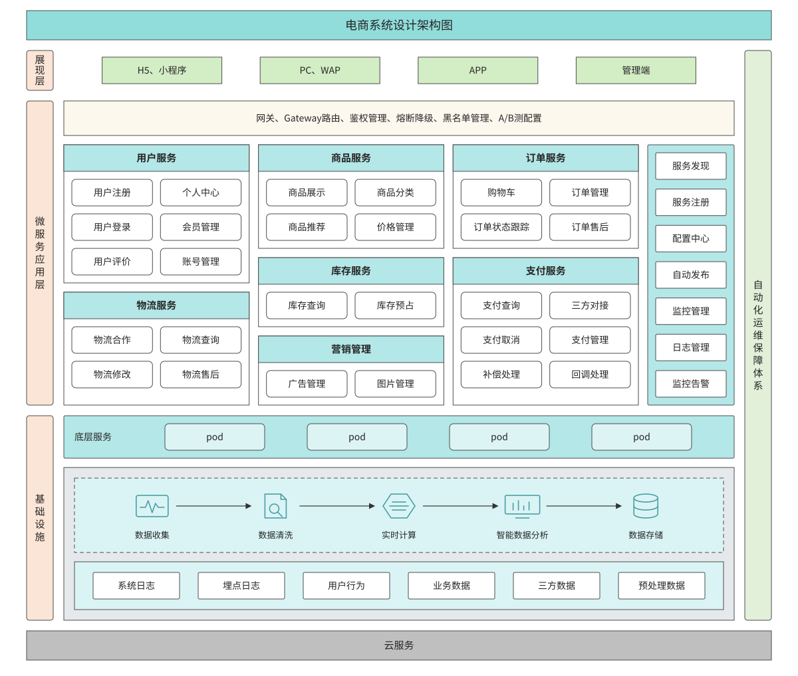

# Nanford-skills

一个持续沉淀个人高频工作流与实战方法论的 **Skill 资产仓库**。

> **核心价值**：不仅是提示词仓库，更是将“能力”模块化。它将日常可复用、可交付的工作流，整理成结构化的 Skill，旨在将 AI 转化为真实的生产力单元。

---

## 🛠️ 收录范畴

目前仓库聚焦于以下三大核心维度，持续整合已验证的实战技能：

| 维度 | 重点解决场景 | 价值目标 |
| :--- | :--- | :--- |
| **内容创作** | 爆款拆解、风格复刻、信息差提炼、视觉配图 | 提升内容的传播力与认知冲击 |
| **办公效率** | 文档/会议材料整理、PPT 规划与渲染、知识库沉淀 | 极致提升日常琐事的产出效率 |
| **业务实战** | 售前方案、投标应标、需求拆解、行业分析 | 强化复杂业务场景下的逻辑输出 |
| **工业自动化** | PLC 点位映射、站台化补表续表 | 将工程数据整理为可交付表格资产 |

## 🏛️ 官方规范与模板 (Anthropic Official)

本仓库通过 Git Submodule 引入了 [Anthropic Official Skills](https://github.com/anthropics/skills) 的核心规范与模板。

*   **同步路径**：`skills/official/`
*   **如何手动同步**：
    ```bash
    # 进入官方目录手动 pull
    cd skills/official
    git pull origin main
    # 或者从根目录一键更新
    git submodule update --remote
    ```
*   **核心参考**：
    *   [📜 官方 Skill 编写规范](https://github.com/anthropics/skills/blob/main/spec/agent-skills-spec.md) (GitHub 预览)
    *   [🛠️ 官方 Skill 结构模板](https://github.com/anthropics/skills/blob/main/template/SKILL.md) (GitHub 预览)
    *   *本地路径：`skills/official/spec/agent-skills-spec.md`*

---

## 📂 个人原创 Skill 索引

### 🔍 1. viral-article-analyzer
> **定位**：公众号爆款文章深度拆解系统

*   **核心价值**：不止于总结，更在于复盘传播背后的“情绪钩子”与“逻辑路径”。
*   **适用场景**：拆解对标账号、分析爆款原因、沉淀可复用的写作方法论。

### ✍️ 2. wechat-article-operator
> **定位**：公众号内容生产系统 (V3)

*   **核心价值**：覆盖选题评估 → 读者锚定 → 结构选型 → 正文写作 → 传播元素植入 → 运营拆解的全链路。
*   **适用场景**：热点解读、工具测评、趋势判断、观点文章、初稿升级改稿。
*   **V3 新增**：选题五维评估、读者画像锚定、五种正文结构自动推荐、三档深度控制、改稿诊断表、工具链衔接。
*   **推荐工具链**（可选，需额外安装对应 Skill）：

    | 环节 | 推荐 Skill | 来源 |
    | :--- | :--- | :--- |
    | 排版 | `wechat-article-formatter` | [iamzifei 公众号排版 Skill](https://github.com/iamzifei/wechat-article-formatter-skill)  |
    | 发布 | `baoyu-post-to-wechat` | [baoyu 社区 Skill](https://github.com/JimLiu/baoyu-skills) |
    | 封面图 | `baoyu-cover-image` | baoyu 社区 Skill |
    | 文中配图 | `baoyu-article-illustrator` | baoyu 社区 Skill |
    | 爆文分析 | `viral-article-analyzer` | 本仓库 ✅ |

### 🏗️ 3. prototype-orchestrator-pro
> **定位**：从模糊需求到可交互原型的自动化编排器

*   **核心价值**：需求归一化与可视化。直接将口语化需求转化为可交互的 HTML 原型。
*   **适用场景**：快速原型验证、产品规格评审、方案视觉化演示。

### 📐 4. processon-diagrams
> **定位**：ProcessOn 风格多图种 SVG 图表生成器（由 `svg-architecture-diagram` 升级重构）

*   **核心价值**：将文字描述转化为 ProcessOn 模板风格的矢量 SVG 图表，内置零外部依赖 Python 渲染脚本，自动计算坐标、换行与对齐，杜绝节点重叠与溢出，并支持无头浏览器导出 PNG 预览自检。
*   **多图种架构**：按“路由入口 + 共用核心（主题/排版/图元/箭头/导出）+ 图种渲染器”拆分，当前支持**分层架构图（`architecture`）**，便于后续扩展甘特图、泳道图、流程图等常用辅助阅读图形。
*   **5 套 ProcessOn 主题**：青绿经典（默认）/ 科技蓝 / 清新绿 / 活力橙 / 商务灰，低饱和浅色块 + 1px 细描边，按语义角色统一取色。
*   **技术亮点**：几何拼接箭头替代 SVG `<marker>`，确保导入 PPT、Word、公众号编辑器不丢箭头；左侧竖排层标签、右侧支撑体系栏、多列卡片网格自动底对齐。

**效果预览**：



### 📡 5. ai-news-scout
> **定位**：AI 信息差日报生成工具

*   **核心价值**：通过 3 批并行搜索（大厂动态 / 社区开源 / 产品商业）高效采集全网 AI 新闻，自动去重合并后输出精炼的信息差日报。
*   **适用场景**：AI 日报生成、信息差选题、行业动态速览。
*   **核心特性**：
    *   3 批 Agent 并行搜索，覆盖官方公告、HN/Reddit/GitHub、融资与产品动态
    *   自动去重合并，按事件主体聚合多源报道
    *   6 类分类标签：模型发布 / 产品更新 / 开源动态 / 融资收购 / 政策监管 / 行业趋势
    *   精简 5 维分析 + 3 维评分（30 分制），信息密度高
    *   输出 `ai-news-{YYYY-MM-DD}.md` 日报文件，5 分钟掌握当日 AI 动态

### 🎬 6. hootoolai-ppt
> **定位**：多主题企业级演示文稿生成器 + 自动配图

*   **核心价值**：将文本内容转化为 Bento Grid 布局的 HTML 演示文稿，并自动调用 AI 图片生成工具为幻灯片配图。输出 HTML + 素材文件夹，浏览器打开即可演示。
*   **适用场景**：科技发布、工作汇报、客户提案、培训材料、学术演示。
*   **6 种主题**：赛博暗夜 / 科技蓝 / 简洁汇报 / 暖光办公 / 软件公司 / 极简白，根据场景自动推荐。
*   **素材生成**：自动识别配图需求，调用 `baoyu-image-gen`、`baoyu-article-illustrator` 等 Skill 生成封面图、概念配图、数据图表；简单图标直接内联 SVG 绘制。
*   **推荐工具链**（可选，需额外安装对应 Skill）：

    | 环节 | 推荐 Skill | 来源 |
    | :--- | :--- | :--- |
    | 封面/配图生成 | `baoyu-image-gen` | [baoyu 社区 Skill](https://github.com/JimLiu/baoyu-skills) |
    | 矢量插画配图 | `baoyu-article-illustrator` | baoyu 社区 Skill |
    | 信息图/图表 | `baoyu-infographic` | baoyu 社区 Skill |
    | 封面大图 | `baoyu-cover-image` | baoyu 社区 Skill |

### 📊 7. article-to-ppt-outline
> **定位**：长文本转结构化 PPT 大纲生成器（规划层）

*   **核心价值**：将长篇文档、业务教材转换为带有“视觉排版建议”和“讲师口语化逐字稿”的结构化大纲，为下游渲染提供逐页规划。
*   **适用场景**：快速备课、制作汇报演示文稿的大纲梳理阶段。
*   **推荐工具链**：大纲完成后交由 `text-to-ppt-pro` 渲染为可编辑 `.pptx` 文件。

### 👑 8. text-to-ppt-pro
> **定位**：专业 PPT 生成执行层

*   **核心价值**：接收结构化大纲，忠实渲染为可编辑 `.pptx` 文件；支持 13 种标准页型、4 套主题预设、备注区写入与自动质检。
*   **适用场景**：培训课件、项目汇报、立项汇报、方案宣讲等高规格演示需求。
*   **主题预设**：`dark_tech` / `business_blue` / `mckinsey_clean` / `warm_exec`，按受众与场景自动推荐。
*   **参考资产**：`layout-specs.md` 版式规范、`design-system.md` 设计系统、示例 PPT 参考稿。

### 📋 9. bid-preparation
> **定位**：标书响应文件制作全流程 Skill

*   **核心价值**：解析招标文件、匹配公司资料、按流程生成商务 + 技术响应文件，并组装为成品 DOCX。
*   **适用场景**：投标、应标、解标、偏离表编制、资格/符合性/评标导航表整理。
*   **核心能力**：
    *   招标文件与历史响应样本结构化提取，提取失败或疑似扫描件时停止后续编制
    *   按采购体系、采购方式、项目类型及定标方式选择流程，覆盖政府采购、竞争性磋商、工程总承包与评定分离
    *   公司资料索引、证据匹配与缺口跟踪，关联强制条款、偏离表、正文响应和证明材料
    *   商务/技术大纲确认后逐章编制，支持阶段状态记录与断点续作
    *   DOCX 组装、格式校验、内容质量检查及电子标递交清单，支持 Word / WPS 页码处理
    *   辅助脚本：`prepare_project`、`extract_text`、`check_p0_gates`、`check_content_quality`、`build_response_docx`、`validate_bid_package` 等

### 🎨 10. minimal-narrative-sketch-scenes
> **定位**：极简手绘叙事小场景图像提示词生成器

*   **核心价值**：围绕任意主题生成高质量 16:9 横版插图提示词——多组松散动作小场景、强留白、轻快叙事感，介于儿童涂鸦与设计草图之间。
*   **适用场景**：文章配图、培训课件插图、社交媒体视觉、品牌故事草图风格表达。
*   **核心特性**：多变叙事结构模板、动作瞬间编排、统一手绘气质约束，避免精细插画或整齐图标化。

### ⚙️ 11. plc-station-db-mapper
> **定位**：西门子 PLC 站台化项目点位映射 Skill

*   **核心价值**：将 DB 截图、PDF 导出、Excel 导出或手动输入等多种原始格式，标准化为统一 Excel，并批量生成目标站台点位表。
*   **适用场景**：Task / Alarm / State 等类别点位的扩展、补表、续表。
*   **4 种输入路径**：DB 截图 → 标准化 Excel；PDF 导出；XLSX 导出；手动输入偏移与结构。
*   **原则**：以本次项目数据为准，不默认复用历史固定偏移模板。

### 🗺️ 12. architecture-diagram
> **定位**：无连线架构图视觉设计 Skill（`.agents/`）

*   **核心价值**：通过层级、分组、对齐与留白传达系统结构，默认不绘制箭头与连接线，输出克制、专业的架构视觉。
*   **适用场景**：系统总览、平台地图、方案蓝图、技术全景、分层能力视图（HTML / SVG / 幻灯片 / 图片）。
*   **设计原则**：以 containment 与 spatial organization 替代 connector web；仅在用户明确要求时添加最少必要连线。

### 🛒 13. 电商 Listing 生产工作流
> **定位**：商品理解、站点文案、套图生成、发布质检与刊登导出的三段式 Skill 工作流

| Skill | 工作阶段 | 核心产物 |
| :--- | :--- | :--- |
| `ecom-listing` | 商品事实、选项收集、站点文案、套图规划 | `listing.json`、`strategy.json`、`copy.json`、`image_jobs.json` |
| `ecom-image` | 无文字底图生成、准确文字图层合成 | `base_images/`、`final_images/`、渲染清单 |
| `ecom-publish` | 规则质检、视觉验收、平台字段映射 | `quality-report.json`、`listing_export.csv` |

*   **交互原则**：用户已说明的选项直接采用；缺失且会影响交付结果的选项使用原生结构化选择控件，不使用文本问卷。
*   **图片提供方**：Codex ImageGen、Qwen Image 3.0 Pro、Nano Banana 2、火山引擎 Seedream。
*   **续跑能力**：每个阶段落盘中间产物，上游修改后从最早受影响的位置继续。
*   **文案安全**：硬参数必须有来源，图片仅补充可直接观察事实，待确认属性不得进入公开文案。

### 14. bid-document-builder
> **定位**：招标文件、采购文件与竞争性磋商文件编排 Skill

*   **核心价值**：复制整份 Word 参考文件并原位改编，保留章节、表格、分节、封面图片及页眉页脚。
*   **适用场景**：编制或重制招标文件、采购文件、磋商文件，以及严格对照参考格式进行套版。
*   **来源核验**：提取 Excel 工程量与报价数据，记录来源单元格并复算数量、单价和合价，列出冲突供核验。
*   **关键字段审计**：项目名称、招标编号、保证金、账户、评分及合同变量标红，检查未处理占位和参考项目旧值。
*   **结构校验**：生成参考文件结构清单，对比改编后的标题、表格与媒体结构；封面另有样式提取和保真检查流程。
*   **内置参考**：政府采购云平台公开招标范本、装修设计施工总承包招标范本。

### 15. hubei-subsidy-tracker
> **定位**：湖北惠企政策采集、企业匹配与协作通知助手

*   **核心价值**：采集湖北省、武汉市 8 个官方来源，按企业档案筛选申报机会，保留原文链接、匹配依据与待核验条件。
*   **适用场景**：企业补贴查询、企业档案维护、政策机会跟踪、申报资料核对与运行故障恢复。
*   **首次使用**：智能体逐步检查环境、准备资料并验证能力，默认本地模式，支持保存进度和断点继续。
*   **协作方式**：可选飞书群汇总通知，或通过具备相应能力的千问办公宿主接入钉钉 AI 表格与负责人个人通知；通知与定时任务默认关闭。
*   **运行保障**：客户数据与配置独立存放，通知账本防止重复发送，发送结果不明时先核对再恢复。
*   **能力边界**：匹配结果与申报草稿供人工审核，不自动提交申报，不保证覆盖全部政策或通过审核。
*   **入口文档**：[Skill 使用说明](skills/hubei-subsidy-tracker/SKILL.md)。

### qingtian-bid

面向青天大模型评审的施工组织设计 Skill，当前版本为 **2.2**。招标文件未限页时按工程内容展开，不套固定页数；正文可就近插图，施工动作配写实示意，过程管控配可编辑流程图，不固定每节图数。新项目可使用 F6 参考框式版式，招标要求和已确认格式优先。

[Skill 入口](skills/qingtian-bid/SKILL.md) · [单独安装与更新](skills/qingtian-bid/references/installation.md) · [版本记录](skills/qingtian-bid/CHANGELOG.md)

### 🎞️ 16. AI 实战短视频生产工作流（VideoCut）
> **定位**：把选题、公众号文章或录屏做成抖音 / 视频号竖屏成片的 12 个 Skill，由总入口 `video-workflow` 按阶段调度

| Skill | 工作阶段 | 核心产物 |
| :--- | :--- | :--- |
| `video-workflow` | 总入口：阶段顺序、四个人工确认点、计费与发布边界、断点续跑、初始化工作区 | 新工作区（规则文档、模板、标记文件） |
| `video-project` | 建档、素材入库、阶段状态与费用账本 | `project.json`、`assets.json`、`costs/` |
| `script-check` | 配音前文稿闸门、平台敏感词（含截图 OCR）、开头实测 | `script-check.json`、`terms-check.json` |
| `doubao-review` / `jev-check` | 豆包平台风险审核 / Jev 语义提示（计费，带月度上限） | `doubao-review.json`、`jev-check.json` |
| `minimax-tts` / `voice-captions` | MiniMax 配音与逐字时间戳 / 拼接母轨与断句字幕 | `voice.wav`、`captions.json`、SRT |
| `video-timeline` | 毫秒与帧一次算定的统一时间轴 | `timeline.json` |
| `visual-assets` / `remotion-render` | 示意插图 / Remotion 渲染十种场景、语义配色、文字动效、封面与动作标记 | 无声画面、审片静帧、`actions.json` |
| `sfx-kit` / `av-export` | 本地合成界面音效 / 音效轨、混音、封装、质检与交付清单 | `sfx.wav`、`mix.wav`、成片、`delivery.json` |

*   **核心价值**：需要判断的交给智能体，需要精确的交给本地命令；每一步都记录上游校验值，改了哪里只重做受影响的环节。
*   **画面风格**：浅灰底、五种语义色（品牌 / 痛点 / 解法 / 数据 / 提醒）按文案意思选色；文字动效含落下、弹出、数字滚动、划掉换词、荧光笔、打字、飞入飞出、粒子消散。
*   **驱动方式**：Codex、Claude Code 等能读文件、能在本机运行 Python 3.10+、Node.js 22.6+ 与 FFmpeg 的智能体。
*   **工作区**：`videocut.workspace.json` 标记工作区（或用环境变量 `VIDEOCUT_WORKSPACE`），`.env`、项目文件和付费接口用量账本都放在工作区里，技能装在全局目录也不会写错位置。
*   **入口文档**：[video-workflow](skills/video-workflow/SKILL.md)；完整规则在 [references/workspace/](skills/video-workflow/references/workspace/)。
*   **素材许可**：Lucide 图标为 ISC 许可（许可全文随附）；6 张风景底图为 Unsplash License（作者与来源见清单），另 15 张安装时从图库 CDN 下载；字体安装时按固定版本下载（SIL OFL 1.1）。这些素材不适用本仓库的 MIT 许可。

---

## 🏗️ 仓库目录结构

```text
Nanford-skills/
├── README.md
├── .gitignore                    # 项目忽略配置
├── .agents/                      # Agent 专用 Skill
│   └── skills/
│       └── architecture-diagram/ # 无连线架构图视觉设计
├── install-video-skills.ps1       # 视频工作流 12 个 Skill 的安装脚本
└── skills/                       # 核心 Skill 目录
    ├── qingtian-bid/             # 青天评审施组、工艺配图、PDF 交付
    ├── video-workflow/           # 视频生产总入口（references/workspace/ 为规则文档与模板）
    ├── video-project/ … av-export/  # 视频工作流其余 11 个 Skill，各带 scripts/、tests/、agents/
    ├── hubei-subsidy-tracker/     # 湖北惠企政策采集、企业匹配与协作通知
    │   ├── SKILL.md              # 首次引导、日常运行与故障恢复入口
    │   ├── scripts/              # 采集、匹配、通知、状态管理与分发打包
    │   └── references/           # 接入指南、字段规范与配置模板
    ├── ecom-listing/             # 商品理解、文案与套图工单
    ├── ecom-image/               # 多提供方出图与文字合成
    ├── ecom-publish/             # 发布前质检与刊登导出
    ├── article-to-ppt-outline/
    │   └── SKILL.md              # 规划层 (长文本 -> PPT大纲)
    ├── text-to-ppt-pro/
    │   ├── SKILL.md              # 执行层 (大纲 -> .pptx 渲染)
    │   ├── assets/               # 主题预设
    │   └── references/           # 版式规范、设计系统、检查表、参考 PPT
    ├── bid-preparation/
    │   ├── SKILL.md              # 标书响应文件制作
    │   ├── scripts/              # 文本提取、资料索引、DOCX 组装与校验
    │   ├── templates/            # 投标函、偏离表、导航表等模板
    │   └── references/           # 解标参考卡片
    ├── bid-document-builder/
    │   ├── SKILL.md              # 招标及采购文件编排
    │   ├── scripts/              # 原位改编、来源映射与结构审计
    │   ├── assets/               # 政府采购与工程总承包参考范本
    │   └── references/           # 结构、封面、法规与废标项参考
    ├── minimal_narrative_sketch_scenes_skill/
    │   └── SKILL.md              # 极简手绘叙事小场景提示词
    ├── plc-station-db-mapper/
    │   ├── SKILL.md              # PLC 站台点位映射
    │   ├── scripts/              # 表格生成与 Excel 标准化
    │   └── reference/            # DB 截图、变量表等参考样例
    ├── hootoolai-ppt/
    │   ├── SKILL.md              # 多主题 HTML 演示 + 素材生成
    │   ├── assets/               # HTML 模板 (CSS 主题系统 + JS 演示引擎)
    │   ├── examples/             # 完整演示示例
    │   └── references/           # 设计系统规范与幻灯片模板
    ├── prototype-orchestrator-pro/
    │   ├── SKILL.md              # 需求 -> 可交互 HTML 原型
    │   ├── agents/               # 智能代理配置
    │   ├── assets/               # 渲染模板与静态资产
    │   ├── examples/             # 最佳实践示例
    │   └── references/           # 设计规范与方法论参考
    ├── ai-news-scout/
    │   ├── SKILL.md              # 3 批并行搜索 + 去重 + 分类
    │   └── references/           # 输出模板
    ├── processon-diagrams/
    │   ├── SKILL.md              # 多图种路由入口（JSON 模型 → ProcessOn 风格 SVG）
    │   ├── references/           # 共用视觉规范、5 套配色主题 & 分图种规范
    │   ├── scripts/              # 统一渲染入口 render.py、core 核心库 & diagrams 渲染器
    │   └── examples/             # 图种示例 JSON 与成品 SVG
    ├── viral-article-analyzer/
    └── wechat-article-operator/
        ├── SKILL.md              # V3 核心指令
        └── references/
            ├── article-structures.md  # 五种正文结构详解
            └── output-examples.md     # 风格示例与改稿诊断
```

---

## 🚀 使用与演进

### 单独安装 qingtian-bid

使用支持 `gh skill` 的 GitHub CLI。Codex 和 Claude Code 任选对应命令：

```powershell
gh skill install Nanford/Nanford-skills skills/qingtian-bid --agent codex --scope user
gh skill install Nanford/Nanford-skills skills/qingtian-bid --agent claude-code --scope user
```

也可把这句话发给 Agent：“请从 Nanford/Nanford-skills 的 skills/qingtian-bid 单独安装 Skill，为当前 Agent 做用户级安装并保留 GitHub 更新跟踪。”

安装后开启新会话。首次使用时，Skill 会在 GitHub CLI 可用且有安装来源记录时检查是否有更新。看到提醒可回复“更新 qingtian-bid”。[更新命令和旧版迁移方法](skills/qingtian-bid/references/installation.md)

维护时，同步 `skills/qingtian-bid/`、本页的当前版本和 Skill 的版本记录，再推送到 GitHub `main`。从独立仓库同步时保留 Skill 入口的安装更新段落及 `references/installation.md`。更新检查比较该目录的 Git 版本，其他 Skill 的改动不会触发这项提醒。当前按默认分支分发。如果仓库以后使用 GitHub Releases，发布更新时也须检查最新发行版是否包含新版 Skill。

### 电商工作流安装

将仓库中的三个电商 Skill 安装到 Codex 与 Claude Code：

```powershell
powershell -ExecutionPolicy Bypass -File ".\install-ecom-skills.ps1" -Agent both -Force
```

Codex 依次调用 `$ecom-listing`、`$ecom-image`、`$ecom-publish`；Claude Code 依次调用 `/ecom-listing`、`/ecom-image`、`/ecom-publish`。需要补充关键选项时使用 Agent 的原生选择控件；当前模式不提供该控件时，切换到支持结构化输入的交互模式后继续。

### 视频工作流安装

需要 Python 3.10+（含 `requests`、`pillow`）、Node.js 22.6+、FFmpeg。脚本先检查环境，再复制 Skill，并在每个安装位置执行 `npm ci`、下载字体、恢复底图、生成音效库：

```powershell
powershell -ExecutionPolicy Bypass -File ".\install-video-skills.ps1" -Agent codex
# 之后建一个工作区（每台电脑或每个账号一次），复制 .env.example 为 .env 填密钥
python "$env:USERPROFILE\.codex\skills\video-workflow\scripts\init_workspace.py" D:\VideoWork
```

在工作区目录打开智能体，Codex 用 `$video-workflow`、Claude Code 用 `/video-workflow` 开始。`-DryRun` 只预览，`-SkipSetup` 只复制不安装依赖，`-Force` 更新已安装的版本。这些 Skill 由 VideoCut 仓库单向导出，问题请在源仓库修改。

### 统一标准
每个 Skill 遵循 **“单一职责”** 原则，包含明确的：
- `SKILL.md` (核心指令)
- `references/` (配套案例/模板)

### 演进路线
1.  **实用主义 (v0.1-v0.3)**：优先沉淀高频实操 Skill。
2.  **标准化 (Ongoing)**：统一命名规范、参数配置与版本记录。
3.  **体系化 (Future)**：形成覆盖全业务流的 AI 工作系统。

---

## 📜 版本更新记录

- **v0.11**：将 `svg-architecture-diagram` 重构并更名为 `processon-diagrams`——全面切换为 ProcessOn 模板风格（5 套角色色主题、1px 细描边、几何拼接箭头、自动换行与卡片对齐），按“路由入口 + `scripts/core` + `scripts/diagrams`”拆分为多图种可扩展框架，新增零依赖 Python 渲染脚本与 PNG 预览自检。
- **v0.10**：新增 AI 实战短视频生产工作流（VideoCut）12 个 Skill 与 `install-video-skills.ps1`：总入口 `video-workflow`、文稿闸门与平台审核、MiniMax 配音与字幕、统一时间轴、Remotion 渲染（语义配色与八种文字动效）、系列音效与混音质检交付。
- **v0.9**：新增 `bid-preparation` 标书响应文件制作 Skill（脚本 + 模板 + 参考卡片）；新增 `minimal-narrative-sketch-scenes` 极简手绘叙事小场景提示词 Skill；新增 `plc-station-db-mapper` 西门子 PLC 站台点位映射 Skill；新增 `.agents/skills/architecture-diagram` 无连线架构图视觉设计 Skill；升级 `text-to-ppt-pro` 为 PPT 执行层（13 种页型、4 套主题、`layout-specs` 版式规范、参考 PPT）；`article-to-ppt` 重命名为 `article-to-ppt-outline` 明确规划层定位。
- **v0.8**：新增 `article-to-ppt` 与 `text-to-ppt-pro`，完善 PPT 制作全链路工具；升级 `hootoolai-ppt` 至 V3，引入 PPT-Agent 认知设计逻辑。
- **v0.7**：新增 `ai-news-scout` AI 信息差日报 Skill——3 批 Agent 并行搜索、自动去重合并、6 类分类标签、精简 5 维分析 + 3 维评分、输出结构化日报文件。
- **v0.6**：新增 `svg-architecture-diagram` SVG 架构图生成 Skill——8 种行业配色主题、双画布模式、几何拼接箭头、JSON 模型驱动的专业矢量架构图输出。
- **v0.5**：新增 `hootoolai-ppt` 多主题演示文稿生成 Skill——6 种配色主题、Bento Grid 布局、自动调用 AI 图片生成 Skill 配图、输出 HTML + 素材文件夹。
- **v0.4**：`wechat-article-operator` 升级至 V3——新增选题评估、读者画像、多结构选型、深度档位、改稿诊断、工具链衔接；精简冗余参考文件。
- **v0.3**：新增 `prototype-orchestrator-pro` 原型编排 Skill，重构 README 视觉结构。
- **v0.2**：新增 `wechat-article-operator` 写作升级 Skill。
- **v0.1**：仓库初始化，收录 `viral-article-analyzer` 拆解 Skill。

---

## 📄 License

本项目采用 [MIT License](LICENSE) 协议。你可以自由地学习、分享和修改这些 Skill，但请保留原作者的版权声明。

---

> Skill 不是一句提示词，而是一个能被复用的解决问题单元。
