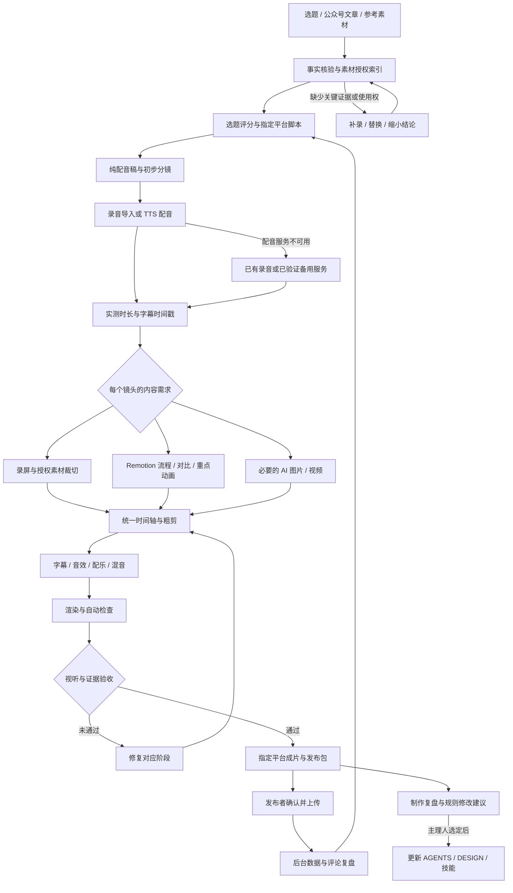

# AI 实战视频号与抖音生产方案

版本：1.2 ｜ 资料核验：2026-09-29 ｜ 1.2 变更：吸收参考视频的剪辑方法（画面增量、设计规则、动作对点、开场打磨、制作复盘），细则见 [docs/EDITING_METHOD.md](docs/EDITING_METHOD.md) ｜ 1.1 变更：改为代码智能体编排、补充中文配音与对齐选型、公众号资产迁移

## 1. 生产定位

账号以「把 AI 用在具体工作里，并展示结果与限制」为核心：一个视频解决一个问题，给出一条可以照做的路径，并用真实素材证明结论。

公众号文章沉淀的案例、判断和操作步骤进入选题库。改编时先找观众的任务，例如整理会议记录、生成汇报初稿、核对表格、制作配图，再确定视频中的证据与动作。文章里的长背景、完整知识体系和多层论证留作补充材料。

每条内容满足三个条件：开头说明值得看的结果；中间展示关键操作或证据；结尾交代适用范围与下一步。没有测过的功能使用「官方公布」「原理示意」等准确表述，实测结论附实际测试条件。

首轮可按 12 条内容安排：6 条工作场景实操、3 条工具对比或失败复盘、2 条重要更新的实际影响、1 条完整流程案例。这是便于比较效果的试验组合，发布时间与产量随实际资源确定。

## 2. 现有方案比较与取舍

| 方案 | 已有能力与价值 | 适用边界 | 采用方式 |
|---|---|---|---|
| MoneyPrinterTurbo | 将主题、文案、素材、语音、字幕和音乐接成短视频生产链；支持本地素材等输入 | 工具能串联流程，不保证素材能证明 AI 产品的实际效果；项目所列海外发布目标不能直接等同于抖音、视频号 | 借鉴模块划分和快速打样；不作为唯一生产工程。依据：[项目说明](https://github.com/harry0703/MoneyPrinterTurbo) |
| NarratoAI | 从已有视频出发进行理解、解说和剪辑，适合研究长素材索引与片段选择 | 更接近影视解说类使用场景，AI 软件实操仍需补录屏证据；软件许可与原视频版权分别核对 | 借鉴素材理解流程，按需要独立接入。依据：[原始项目](https://github.com/linyqh/NarratoAI)、[当前 LICENSE](https://github.com/linyqh/NarratoAI/blob/main/LICENSE) |
| Remotion + FFmpeg | 用 React 组件和数据描述画面，统一生成、合成与导出；FFmpeg 处理媒体和音频 | 需要先建可复用场景；Remotion 本身不负责自动写事实可靠的文案，也不替代 TTS 服务 | 作为主生产底座。依据：[官方 Agent Skills](https://www.remotion.dev/docs/ai/skills)、[FFmpeg 文档](https://ffmpeg.org/ffmpeg-filters.html) |
| Claude Code / Codex + Remotion 技能 | 代码智能体读取项目规则与技能，写文案、改组件、调用本地命令并预览渲染；社区已有「素材→转写→Hook→Remotion 参数→安全区检查→双版本渲染」的公开实践 | 智能体输出不确定，时间换算、媒体处理和费用控制不能只靠提示词；单次会话不等于无人值守 | **作为编排层**。确定性步骤写成可重复执行的本地命令，由智能体按阶段调用并审阅结果。依据：[Remotion Agent Skills](https://www.remotion.dev/docs/ai/skills)、[videocut 公开实践](https://github.com/jaychou6868/videocut) |
| 剪映草稿生成（pyJianYingDraft 等） | 用程序生成剪映草稿，便于在剪映里手工精修字幕、特效和音乐 | 新版剪映草稿常为加密格式，自动导出仅支持 Windows 下 6.8 及以下版本；属于逆向兼容，随剪映更新可能失效 | 不进入主链路；作为「交付可在剪映精修的草稿」的可选扩展，接入前按实际剪映版本验证。依据：[pyJianYingDraft](https://github.com/GuanYixuan/pyJianYingDraft) |
| n8n 等流程编排器 | 将触发器、HTTP 服务和任务状态串联 | 不承担视频渲染；n8n Cloud 不提供 Execute Command，容器内命令也不会自动运行在 Windows 宿主机；每个环节都需在界面里连线维护 | **不采用**。本工作流的判断、改稿和审片都需要理解上下文，由代码智能体直接编排更合适。依据：[n8n 官方说明](https://docs.n8n.io/integrations/builtin/core-nodes/n8n-nodes-base.executecommand/) |

选择 Remotion 与 FFmpeg，主要基于 AI 实战内容对界面清晰度、流程表达、可重复修改和证据展示的要求。这是针对内容形态作出的工程判断，不是这些工具在所有视频类型中都更优。

**生产顺序以配音为时间基准。** 前期分镜确定画面意图和素材需求，最终分镜的时长由实际配音决定。只改一个镜头时复用原配音和其他画面；改了口播才重新计算相关字幕与时间轴。

## 3. 完整生产链

| 环节 | 核心处理 | 交付物与通过条件 |
|---|---|---|
| 任务建档 | 读取主题、受众、素材、预算和账号已有规则；盘点工具是否可用 | 任务说明、能力检查、缺项清单；缺项不妨碍的工作继续推进 |
| 选题核验 | 从官方发布、产品文档和真实测试提炼问题；剔除无法证明的收益 | 候选选题及评分、事实表、来源；核心主张有证据 |
| 文案改编 | 先展示结果或问题，再给操作与边界；形成各平台版本 | 可直接口播的完整脚本，标题和开头候选 |
| 配音稿 | 拆分自然段，处理英文缩写、多音字、单位及停顿 | 纯朗读文本、显示文本、读音表；镜头指令不进入朗读 |
| 文稿检查 | 配音前先跑 `script-check lint` 离线规则与 `script-check terms` 平台敏感词检查（含截图 OCR），再用 `doubao-review review` 审平台违规风险，然后用 `jev-check review` 做语义提示（开头是否具体、受众、夸大收益、口播与所引事实是否一致）；发布包定稿后再跑一次 `terms` 与 `doubao-review` | `script-check.json`、`terms-check.json` 无 error；`doubao-review.json` 无未放行的高风险；`jev-check.json` 的提示逐条处理，待人工项有结论 |
| 配音 | 固定音色试音，按自然语段生成或导入真人录音 | 原始音频、统一格式音轨、服务记录、真实时长 |
| 字幕对齐 | 使用 TTS 时间戳；缺失时用转写对照定稿校正 | 字幕 JSON、SRT；产品名、数字、否定词无误 |
| 素材理解 | 对录屏、视频抽帧、OCR、转写和人工抽查，记录动作与结果区间 | 带时间码的素材索引及授权记录；切点不破坏操作因果 |
| 画面生产 | 每个镜头先写明画面在口播之外新增什么，再选择录屏、实拍、Remotion 或生成画面；复杂镜头先做几秒样片 | 画面文件、组件参数和来源；重要结论出现时展示相应证据；没有只复读口播文字的镜头 |
| 剪辑混音 | 按配音组织画面；加入字幕、音乐与必要音效 | 时间轴、无配乐母版、完整混音版本、可重渲染工程 |
| 成片交付 | 先低清预览，再高清渲染；自动检测及完整视听验收 | 指定平台（默认抖音）的 MP4、封面、文案、字幕、质检报告和素材清单 |
| 发布复盘 | 使用实际后台数据，分平台记录观察窗口与指标口径 | 24 小时、72 小时、7 天观察记录；下一轮单变量试验 |
| 制作复盘 | 返工结束或交付后，对照真实文件与主理人原话复盘制作过程 | `retro/production-retro.md` 与规则修改建议；主理人选定后才改规则与技能 |

## 4. 内容与双平台包装

### 4.1 可持续选题

选题优先级按 100 分计算：受众任务明确 25 分、可展示证据 25 分、结果价值 20 分、原创经验 15 分、时效性 10 分、制作成本可控 5 分。热门但没有证据的题目不进入「实测」栏目。

| 栏目 | 典型内容 | 最关键的证据 |
|---|---|---|
| 一件事怎么做 | 用一个 Skill 从招标文件生成标书初稿 | 原始输入、关键操作、可核对的输出 |
| 同题实测 | 同一份材料交给两种工具 | 相同输入、版本、设置、评价标准及失败样本 |
| 做错一次 | 自动整理后遗漏了什么 | 原输出、问题定位和修复前后差异 |
| 更新值不值得用 | 某项更新改变了哪一步操作 | 官方发布日期、实际可用范围和现场演示 |

不以「震撼」「颠覆」「所有人都该知道」替代具体信息。不虚构节省时间、收入、榜单和普遍适用的结果。

### 4.2 第一轮包装参数

| 项目 | 抖音版本 | 视频号版本 |
|---|---|---|
| 初始时长 | 60～120 秒，一条主结论 | 60～180 秒，补充场景和关键限制 |
| 前段 | 第一句点名人群痛点或优势；3 秒内出现成品画面 | 第一句点名人群痛点或优势；10 秒内展示成品与使用场景 |
| 正文 | 关键操作、对比、结果集中表达 | 操作链条更完整，保留适用条件 |
| 结尾 | 一个可执行动作或与主题相关的问题 | 一份简短行动清单或明确使用边界 |
| 标题与封面 | 具体问题与结果，避免超出证据的承诺 | 明确使用者、工作任务与价值 |

这些参数是试验起点，不是平台官方最优时长、算法权重或流量保证。所有视频控制在 3 分钟以内；教程需要更长时，拆为各自完整的小主题。

### 4.2.1 开场写法

开场只服务一类人，用对方熟悉的场景说话，让有同样经历或想要同样效果的人愿意看完：

| 人群 | 痛点开场示例 | 优势开场示例 |
|---|---|---|
| AI 办公 | 「每次投标，排版和格式检查就要熬一个通宵」 | 「同一份招标文件，我现在半天就能出标书初稿」 |
| AI 学习 | 「教程收藏了几十个，真正会用的没几个」 | 「只学这一个用法，第二天就能用在工作里」 |
| AI 转型 | 「团队都在用 AI，但交付流程一点没变」 | 「把这一步交给 AI 后，整个流程少了一次返工」 |
| FDE | 「客户说要 AI，落地时却不知道从哪一步切入」 | 「我在客户现场，用一个 Skill 跑通了第一条流程」 |
| 初学者 | 「装了三个 AI 工具，还是不知道先干什么」 | 「懂软件安装就行，10 分钟跑出第一个成品」 |
| 中小企业老板 | 「请了人做 AI，钱花了没看到效果」 | 「不加人，先让 AI 接手这一件重复的活」 |

示例只示范句式，实际开场的时长、数字和效果必须来自本条视频的真实实测。开场之后立刻给成品画面，不讲背景、不做自我介绍。

优先复用事实、素材和中段模块；两版分别生成脚本、配音时间轴和包装。内容结构适合共用同一主体时可以复用片段，不能把长版机械加速或从结尾直接截断。

### 4.3 公众号资产迁移与分发假设

公众号「Nanford的AI实战笔记」已沉淀四条主航道、标题公式和粉丝画像（见本机技能 `nanford-article-evaluator` 的运营手册）。视频不另起炉灶，按航道迁移：

| 公众号航道 | 视频形态 | 首发平台假设 | 与公众号的关系 |
|---|---|---|---|
| 热点结论（拿流量） | 24 小时内的 60 秒结论视频：值不值得用、变了什么、适合谁，配一个实测画面 | 两平台同发，抖音优先 | 同一热点按「结论 → 3～5 天实测 → 7～10 天场景沉淀」做三连发，视频与文章同步规划 |
| 流量锚点（做收藏） | 手册或清单的「精华一条」：只讲一个最常用的步骤或坑 | 视频号优先 | 视频负责展示结果，完整手册留在公众号；视频号能否挂公众号文章以实际账号界面为准 |
| 系列信任（养信任） | 固定栏目名 +「第 N 期」+ 下期预告，归入合集 | 两平台 | 与公众号系列同名同期号 |
| 转化资产（建壁垒） | 真实案例复盘，保留更长的操作与判断过程 | 视频号 | 与咨询、培训承接一致；客户材料需脱敏与授权 |

平台差异按以下**工作假设**试验，用复盘数据验证或推翻，不当作平台规则：

- 视频号依托微信关系链与公众号，初期可借助已有公众号读者的转发起量；画像与公众号更接近。
- 抖音以兴趣推荐为主，开头 3 秒的结果展示和完播更关键；受众通常比公众号更宽。
- 抖音对引导到站外（含微信、公众号）有限制，发布文案不写外部联系方式或「私信领取」式导流，以现行社区规范为准。

公众号标题公式可迁移到视频标题和封面：工具名 + 版本 + 核心变化、反常识结论 + 具体场景最适合短视频；「全网完整版」类标题只用于确有完整手册支撑的内容。

**受众已判定（2026-09-29）**：依据公众号 179 条已发表图文的阅读与分享数据，两平台统一面向「需要用 AI 把具体工作做成成品的职场实操者」。业务实操/工具类的阅读中位数与分享中位数分别是模型动态类的约 1.7 倍和 6 倍，日报类不再做。详见 [docs/AUDIENCE.md](docs/AUDIENCE.md)。

## 5. 画面、配音与配乐

### 5.1 三种画面模式

**素材模式**：有录屏、实拍或明确可用的视频时，以素材入点和出点形成剪辑。先索引，再选段。产品操作保留输入—动作—结果；等待过程可以压缩，并注明处理。参考链接只用于理解风格或事实，未确认使用权的素材不直接入片。

**Remotion 模式**：适合流程拆解、概念解释、工具比较、步骤提示和数据卡片。页面是一组随帧变化的画面，包含节奏、运动和文字层级；不得用自动翻页的长文本替代视频。模拟界面标注「示意」，不得用生成页面冒充实测录屏。

画面用来增强口播，不复读口播。每个镜头都要在口播之外提供证据、动作、对比或关系；只让口播文字在屏幕上飞入飞出，就和幻灯片没有区别。分镜时对每个镜头回答三个问题：口播已经说了什么，画面新增什么，屏幕必须留下什么。

**混合模式，默认**：重要操作与结果使用真实录屏，抽象解释使用 Remotion，少量场景补充使用 AI 图片或视频。初始可按画面时长以录屏与证据约 60%、解释动画约 30%、补充画面约 10% 配置，具体随题目调整，不硬凑比例。

图片素材通过 [visual-assets](.claude/skills/visual-assets/SKILL.md) 接入：分镜说明画面用途 → 内置生图工具生成场景或透明主体 → 保存生成记录与本地原件 → 素材入库 → `Illustration` 合成 → 静帧、样片与全片检查。准确标题、数字和标签保留为可编辑文字；真实操作与结果继续使用录屏。当前具备图片素材的工具编排入口与插图渲染场景，真实生成调用须按具体项目验证，外部视频生成服务尚未接通。

横屏录屏放入竖屏时，优先放大当前操作区域，并通过全局概览镜头恢复位置感。关键按钮与结果不能被裁掉。长表格、桌面界面采用局部聚焦、逐项高亮和短暂全貌，不把整个电脑桌面缩成无法阅读的小窗。

Remotion 初始只建设六种场景：结果开场、录屏聚焦、步骤流程、前后对比、证据卡片、行动收尾。统一字体、颜色和间距，用数据和组件参数复用。Remotion 提供面向 Codex 等工具的官方技能，可在建设时选用；软件许可按实际版本与使用主体核对；账号主理人确认为个人使用（2026-09-29），适用个人免费许可，锁定版本后以该版本 LICENSE 为准。[官方技能](https://www.remotion.dev/docs/ai/skills)、[许可](https://github.com/remotion-dev/remotion/blob/main/LICENSE.md)

### 5.2 配音

正式 TTS 候选为火山引擎豆包语音与 MiniMax，Azure Speech 作为备选；保留真人录音导入。豆包语音面向中文场景，检索到的官方文档摘要显示大模型非流式接口支持字级时间戳（SSML 文本不支持），接入时读取完整文档并实测；确认可用后可省去一次转写对齐。是否采用某个音色以中文、英文产品名、数字和长句的同稿试听结果决定，不预设「最好听」。MiniMax 官方接口提供字幕与读音控制相关参数，Azure 提供语音边界事件，均须按所选区域、模型和声音实测。[豆包语音文档](https://docs.volcengine.com/docs/6561/1257584?lang=zh)、[MiniMax 文档](https://platform.minimax.io/docs/api-reference/speech-t2a-http)、[Azure 文档](https://learn.microsoft.com/en-us/azure/ai-services/speech-service/how-to-speech-synthesis)

IndexTTS2、CosyVoice 等开源中文 TTS 可本地免费运行，但需要可用的 NVIDIA 显卡才有实用速度；本机检查未发现 NVIDIA 驱动，暂不作为主链路，需要时可部署到云端 GPU。

配音先使用 15～25 秒代表段检查语气和读音。固定音色后按自然语段生成，保留语境与停顿，避免逐句生成造成拼接感。首次粗估可按普通话每分钟 220～260 字规划，英文与数字另计；剪辑一律以实际音频为准。

服务返回时间戳则优先使用；没有时用 FunASR（Paraformer 中文模型，原生字级时间戳）转写，faster-whisper 作为多语种备选，再对照定稿修正。转写不等于与定稿完全一致，中文词边界也不保证适合字幕展示。转写工具安装在独立 Python 环境（本机默认 Python 3.14，相关依赖可能尚未支持，建议使用 3.11）。[FunASR](https://github.com/modelscope/FunASR)、[faster-whisper](https://github.com/SYSTRAN/faster-whisper)

没有可用 TTS 时，已有录音仍可走完整链路；没有任何配音音频时，只交付明确标注的待配音材料或预览，不伪装为完整成片。

### 5.3 音乐与声音

优先使用有明确跨平台使用权的无歌词音乐，以轻节奏、低干扰为标准。配乐选取记录曲名、作者、授权来源、适用平台和证明；平台内可用音乐不自动视为可带出到另一平台。

每条视频保留独立人声、音乐和音效轨。人声出现时自动压低音乐，句尾逐渐恢复，重要操作和数字处降低干扰。FFmpeg 可实现侧链压缩与响度处理；具体响度目标属于本工作流的制作标准，不宣称是抖音或视频号的强制要求。[音频滤镜文档](https://ffmpeg.org/ffmpeg-filters.html)

AI 作曲作为可选适配器：先核对当前服务、接口、套餐与商业使用范围，再固定曲风和版本保存生成记录。无可用音乐时可交付清晰的人声版本，并在交付表标明配乐缺项；不随机使用来源不明的「免费音乐」。

音效只对准画面里的动作：动作标记以镜头起点为基准，记录触发、接触、状态变化和停稳的毫秒时间；每个音效写明时间点、声源和对应动作。镜头变速、截短或起点调整后，先重新校准再混音。

### 5.4 设计规则与运动语言

系列的视觉与运动语言记录在 `docs/DESIGN.md`，决定片子有没有自己的辨识度，由主理人拍板。建立方法：静态测试用参考图和同一镜头的多套主题静帧比较背景、圆角、卡片与强调色；动态测试以迪士尼动画 12 原则为检查词，重点看形状连续变换、元素交互、跟随运动和挤压拉伸。两项满意后写入 `DESIGN.md`，数值同步到 `remotion-render` 主题代码。单期镜头的构图、帧数和时长不回写为系列默认。2026-09-30 已按首条成片建立（浅灰底、单一紫色强调、毛玻璃卡片、硬切 + 镜头内入场、品牌胶囊常驻、不画 AI 角标、问句式痛点开场），多套主题静态测试与动态测试待下次改风格时补做。完整程序见 [docs/EDITING_METHOD.md](docs/EDITING_METHOD.md) 第 4.2 节。

开场作为独立镜头组单独打磨，先出至少两版方案再选定；封面每期取两张参考图，一张定画风、一张定构图。

## 6. 工程组织与建设顺序

### 6.1 由代码智能体编排

不使用 n8n 等可视化编排器。Claude Code 或 Codex CLI 在本目录打开，读取 `AGENTS.md`（Claude Code 通过根目录 `CLAUDE.md` 引用同一份规则），按阶段推进并在关键节点停下来给人确认。ChatGPT 网页对话不能运行本机 FFmpeg 和 Remotion，只适合写稿与讨论；执行链路使用能操作本地文件和命令的 Codex CLI / Claude Code。

分工原则：**需要判断的交给智能体，需要精确的交给程序。**

| 由智能体完成 | 由本地命令完成（可重复执行、结果写入清单） |
|---|---|
| 选题检索与评分、事实核验、指定平台脚本、配音稿与读音表、分镜、素材索引复核、Remotion 组件编写、审片意见、封面与发布文案 | TTS 调用与缓存、音频格式统一、转写对齐、ffprobe 检查、时间轴与帧换算、混音与响度、渲染、质检报告、费用记账 |

本地命令按环节拆成独立技能，放在 `.claude/skills/<技能名>/scripts/`，每个技能读取上游文件、写出产物，重复执行时命中缓存，不重复计费；产物与阶段状态统一由 `video-project` 技能登记到 `project.json`。智能体只调用命令、读取结果和修改输入数据，不在对话里手算时间码。

人工确认点只保留四个：选题定稿、脚本定稿（含朗读一遍配音稿）、音色试听（首次）、成片审看；发布由账号持有人操作。其余阶段在授权范围内连续执行。

选题由用户按个人风格确定，不接入选题类技能。用户可直接指定素材库（`videocut.workspace.json` 的 `article_library`）中的文章作为改编来源；该目录只读引用，项目内只记录路径与校验值。

已安装的技能按阶段复用：

| 阶段 | 可用技能 | 用法 |
|---|---|---|
| 口播稿 | `human-writing` | 改成口语化配音稿；该技能禁用冒号与破折号，正好避免 TTS 读错标点 |
| 画面 | `remotion-best-practices` | 编写和检查 Remotion 场景 |
| 封面 | `baoyu-cover-image` | 生成封面底图，准确文字由排版层叠加 |

本项目自有技能放在 `.claude/skills/`，每个环节一个独立技能，单独调用、测试和迭代，清单见 [.claude/skills/README.md](.claude/skills/README.md)。已完成：`video-project`（项目建档、素材、状态、费用）、`minimax-tts`（配音）。需要批量或定时运行时使用智能体的非交互模式（如 `claude -p`），仍然调用同一套本地命令。

### 6.2 工程组成

技能默认使用 Python（2026-09-29 确认的方案 A）：项目管理、配音、字幕、时间轴、混音、质检均为 Python；只有 Remotion 渲染技能使用 Node.js / TypeScript，其依赖与锁文件放在该技能目录内。FFmpeg / ffprobe 处理与检查媒体。每个技能固定自己的依赖版本，不把所有依赖装入同一个全局环境。

| 能力 | 初始采用 | 可替换方式与接入条件 |
|---|---|---|
| 选题、文案、分镜 | Claude Code / Codex 会话完成 | 批量阶段使用智能体非交互模式，保持相同数据合同 |
| 真实演示素材 | 自有录屏、已授权参考视频 | 录屏可人工采集；自动操作账号须有明确操作范围 |
| 动画与合成 | Remotion + FFmpeg | 始终保留可重渲染工程与输入数据 |
| 平台风险审核 | 当前：技能 `doubao-review`，火山方舟豆包大模型（默认 doubao-seed-2-0-lite，2026-09-30 用户授权每月上限 ¥20）；位于 `script-check terms` 之后、配音之前，上传前再审发布文案；高风险拦截 | 豆包与抖音同属字节，判断可作参考，不是平台正式审核；模型须在方舟控制台开通；单价来自搜索摘要，待控制台核对。依据：[方舟 Chat API](https://doubao.apifox.cn/265892759e0)、[模型价格](https://www.volcengine.com/docs/82379/1099320) |
| 文稿语义检查 | 当前：技能 `jev-check`，TypeSafe Jev 决策模型（已校准 jev-1.13.0，2026-09-29 用户授权每月上限 1 美元）；位于 `script-check lint` 之后、配音之前，只提示不拦截 | Jev 只读文字、不生成内容，中文准确度官方称不稳定；模型版本变化后先 `calibrate` 再信任结果。依据：[模型与价格](https://docs.typesafe.ai/models.md)、[API](https://docs.typesafe.ai/api.md) |
| 配音 | 当前：技能 `minimax-tts`，MiniMax speech-2.8-hd，音色「温润男声」`Chinese (Mandarin)_Gentleman`（2026-09-29 用户指定，替换 2026-09-23 确认的「沉稳高管」）；豆包语音为并列候选 | 保留扩展：豆包语音、Azure Speech、真人音轨；有 GPU 时可评估 IndexTTS2 / CosyVoice。每个服务做成独立技能，按同一产物格式输出，可随时切换 |
| 字幕 | TTS 字级/词级时间戳 + 定稿校正（当前取 MiniMax 词级时间戳） | 保留扩展：FunASR Paraformer 转写对齐；faster-whisper 备选；whisper.cpp（Remotion 官方转写路径）。用于真人录音等没有时间戳的音频 |
| 生图 | 可用且获授权的会话生图工具 | 独立程序可采用 Qwen-Image 官方 API；会话工具不假定能被本地脚本直接调用。依据：[官方接口](https://help.aliyun.com/zh/model-studio/qwen-image-api) |
| 生视频 | 火山方舟 Seedance 作为候选扩展 | 先核对账号模型权限、费用与条款；保存任务 ID 后查询，不阻塞已有素材剪辑。依据：[官方说明](https://docs.volcengine.com/docs/ark/seedance-1-5-pro?lang=zh)、[任务查询](https://docs.volcengine.com/docs/ark/list-video-generation-tasks-api?lang=zh) |
| 配乐 | 有授权的跨平台音乐库 | AI 作曲服务作为独立适配器，经条款核验与试听后接入 |
| 任务调度 | 代码智能体 + 本地清单与阶段状态 | 批量时用智能体非交互模式逐项目执行；不引入 n8n |
| 剪映精修 | 不包含 | 可选生成剪映草稿供手工精修，按实际剪映版本验证后接入 |

会话中可调用的工具与无人值守程序可访问的接口分别登记。完整自动化依赖实际凭据、资源和本地工作进程，不能仅靠一份提示词或云端流程图实现。

任务通过文件状态连续保存；配音、生图、素材理解等外部能力通过可替换适配器接入。每一步记录输入摘要、版本、文件校验值、费用和输出，允许中断后从已验证的阶段继续。

| 阶段 | 建设范围 | 完成标准 |
|---|---|---|
| 第一阶段：最小成片 | 导入录音、已有录屏、一个 Remotion 场景、字幕、授权配乐、导出与检测 | 生成一条约 30 秒测试片，中文正常、声音清晰、时间轴对齐，保留工程 |
| 第二阶段：生产模板 | 六种场景、任务建档、文案与配音稿、一个正式 TTS、素材索引、两平台版本 | 同一真实选题交付两版完整视频、封面与发布包 |
| 第三阶段：稳定运行 | 缓存、费用上限、阶段失效、失败恢复、参考视频检索与质量报告 | 通过标准、边缘和故障场景；恢复任务不重复扣费或破坏原文件 |
| 第四阶段：按需扩展 | 生图、生视频、AI 作曲、后台数据导入、批量排队、剪映草稿导出 | 每项扩展独立验证，再加入正式工作流 |

镜头生成任务与合成任务分开，昂贵的素材先批准镜头需求再生成；已经授权的预算内无需逐镜头重复确认。失败重试只覆盖对应镜头和受影响的下游步骤。

成本账包含：文本模型输入输出、TTS 字符、图片数量、视频秒数、音乐任务、渲染资源，以及失败重试的实际费用。预算示例不等于行情报价；首次生产读取服务当前价格，分别记录估算额、已发生额和待结算任务额。生产用时以实测记录，未验证前不承诺「几分钟全自动出片」。

## 7. 交付与持续改进

每条选题的交付包含 `brief.platforms` 所列平台（默认只有抖音）的成片与无配乐母版、独立音轨、SRT、封面、标题与说明、事实与素材清单、可重渲染工程、检测报告。无配乐母版保留必要的 AI 内容标识；如需使用平台音乐，从母版在对应平台添加。

发布前落实素材与声音使用权、个人信息遮挡、事实时效及生成合成内容标识。国家标识办法已于 2025-09-01 施行，工作流保存生成来源与已有标识，发布者使用平台现行声明功能，不恶意删除或隐匿标识。[网信办说明](https://www.cac.gov.cn/2025-03/14/c_1743654685899683.htm)、[抖音用户协议](https://www.douyin.com/agreements/?id=6773906068725565448)

发布默认由账号持有人操作；获得具体账号、具体成片和操作范围的授权后才可执行平台发布。视频号的发布入口、可选封面比例和后台指标以实际账号界面核对，本方案不虚构未经验证的固定路径。

复盘分别记录平台、视频时长、发布时间、观察窗口、播放量、平均观看时长、完播、收藏、分享和新增关注。平台没有提供的指标记为缺失，不填零、不从其他平台推算。以同平台同类内容的历史中位数为参照，分析掉点与证据出现的位置。

制作过程另做复盘：一段实质返工结束后或整期交付后，按 [templates/production-retro.md](templates/production-retro.md) 对照真实文件与主理人原话，区分「规则没写」与「写了没执行」，分开通用方法、系列偏好和本期特例，并列出可删减的规则。复盘只产出修改建议，主理人选定后再改规则与技能。本流程以定稿配音为时间基准，只适合在锁定的时间线上做内容；结构调整放在配音定稿前完成。

每轮只调整一个主要变量：开头、选题角度、证据展示位置、时长或封面。相近主题进行配对观察，记录发布时间等干扰因素，避免把一次播放波动解释为因果。公众号继续承接详细图文、完整步骤和资料，视频负责展示单个问题与实际结果。
